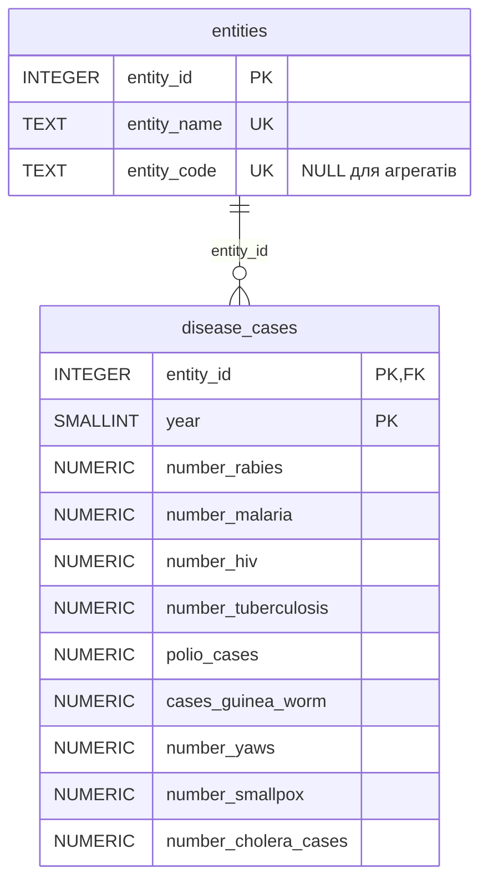

# goit-rdb-fp: фінальний проєкт, датасет `infectious_cases`

Статистика інфекційних захворювань (rabies, malaria, HIV, tuberculosis, polio, cholera та ін.) за країнами, регіонами й роками. Виконано в **PostgreSQL 16**.

## Структура репозиторію
```
final_project.sql          # увесь SQL проєкту (завдання 1–5), запускається через psql
fp_pandemic.ipynb          # notebook з виконаними запитами і результатами (генерується з final_project.sql)
screenshots/*.png          # SQL і результат кожного кроку (19 зображень)
data/infectious_cases.csv  # вихідний датасет (10 521 рядок)
README.md
```

## Як запустити
**psql:**
```bash
createdb pandemic_db
psql -d pandemic_db -v ON_ERROR_STOP=1 -f final_project.sql
```

**Notebook (Google Colab):** відкрити `fp_pandemic.ipynb` → Runtime → Run all. Якщо `data/infectious_cases.csv` відсутній, файл завантажується з курсового Google Drive через `gdown`. Notebook виконує ті самі блоки, що й `final_project.sql` (розмітка `-- @block`), і генерує скриншоти.

## Що зроблено

**1. Завантаження.**
- `CREATE SCHEMA IF NOT EXISTS pandemic; SET search_path TO pandemic;`
- Імпорт CSV у `pandemic.infectious_cases` через `\copy` (у notebook — `COPY ... FROM STDIN`). Raw-таблиця має колонки `TEXT`, як у попередніх ДЗ, тож імпорт не падає, а порожні значення зберігаються як у файлі.

**2. Нормалізація до 3НФ.**
- Ключ вихідної таблиці — `(Entity, Year)`, а `Code` залежить лише від `Entity`. Ця часткова залежність порушує 2НФ, тому таблицю декомпозовано:



- Перевірки: залежність `Entity → Code` (0 порушень) і lossless-join (з'єднання таблиць точно відтворює вихідну).

**3. Аналіз `Number_rabies`.**
- `AVG / MIN / MAX / SUM` для кожної сутності, сортування за середнім `DESC`, `LIMIT 10`.
- Фільтр `IS NOT NULL` обов'язковий: у PostgreSQL `DESC` за замовчуванням ставить `NULLS FIRST`, і без нього топ-10 складався б із 19 сутностей без даних. Це показано окремим запитом.
- Додатково — топ-10 лише країн (ISO-3 коди).

**4. Різниця в роках.** `MAKE_DATE(year, 1, 1)`, `CURRENT_DATE`, `EXTRACT(YEAR FROM AGE(CURRENT_DATE, MAKE_DATE(year, 1, 1)))`.

**5. Функції.**
- `fn_years_since(p_year INTEGER) → INTEGER` — `STABLE STRICT`, бо залежить від `CURRENT_DATE`.
- `fn_avg_cases_per_period(p_cases_per_year NUMERIC, p_divisor INTEGER) → NUMERIC` — `IMMUTABLE STRICT`, дільник ≤ 0 відхиляється явною помилкою.
- Обидві використано в запитах. Друга застосовується лише до числових значень (regex-фільтр на сирій таблиці) з дільниками 12 / 4 / 2.
- Коректність перевірено для всіх рядків.

## Примітки
- Результати завдань 4–5 (`CURRENT_DATE`) залежать від дати запуску; скриншоти зроблено 2026-11-05.
- Скриншоти згенеровано з notebook (matplotlib): на кожному — текст SQL і результат його виконання.
